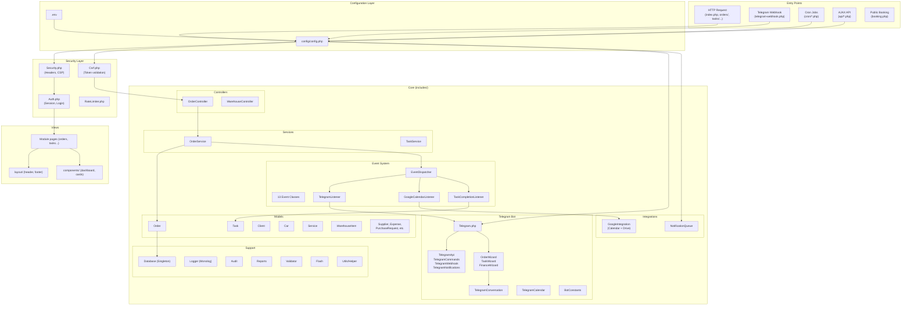
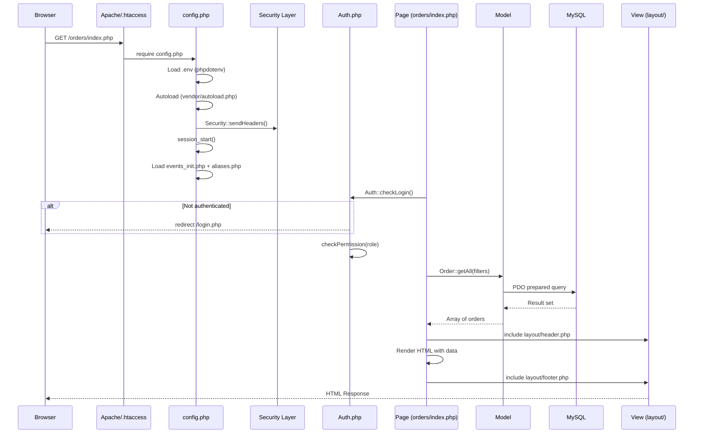
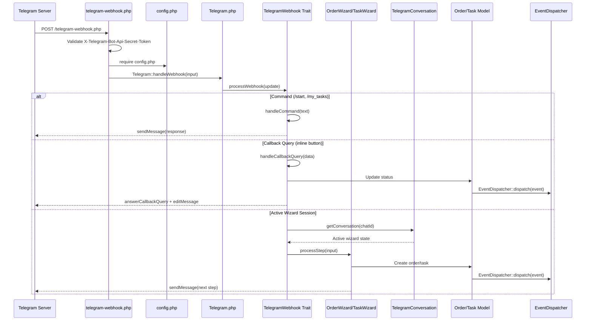
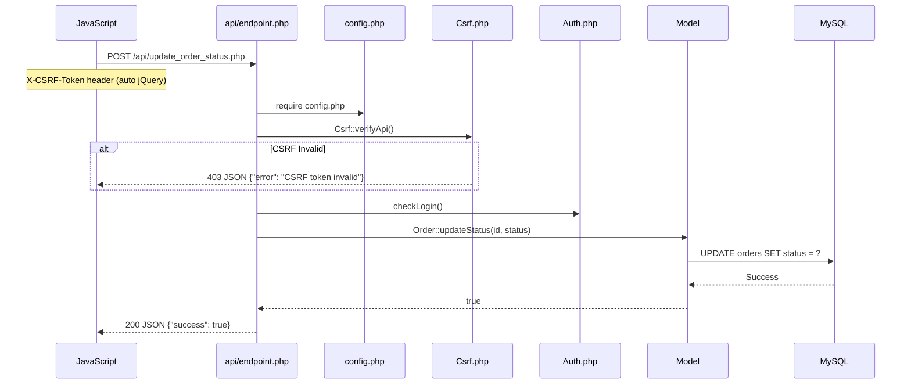
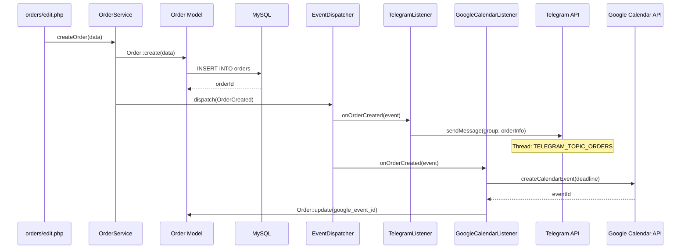

# Архітектура DetalStudio

## 1. Загальний огляд

DetalStudio побудована на **custom MVC** архітектурі без важких фреймворків. Система використовує **Event-Driven** підхід для побічних ефектів (Telegram-повідомлення, Google Calendar синхронізація, каскадні дії).

### Ключові архітектурні рішення

| Рішення | Реалізація |
|---------|------------|
| MVC без фреймворку | Власні Models, Controllers, Views |
| PSR-4 Autoload | `App\` → `includes/` (Composer) |
| Singleton DB | `App\Database` — єдине PDO підключення |
| Event/Listener | `EventDispatcher` з реєстрацією в `events_init.php` |
| Trait composition | Telegram bot складається з 4 traits + 3 wizards |
| Config from env | `.env` → `config.php` → PHP constants |
| Global aliases | `aliases.php` — короткі імена класів у views |

---

## 2. Діаграма компонентів



---

## 3. Request Lifecycle

### HTTP Request (Web)



### Telegram Webhook



### API Request (AJAX)



---

## 4. Namespace та структура класів

```
App\                              # Root namespace → includes/
├── Auth                          # Аутентифікація та авторизація
├── Audit                         # Логування змін (audit_log)
├── BotConstants                  # UI константи Telegram бота
├── Csrf                          # CSRF токени
├── Database                      # Singleton PDO
├── FinanceWizard                 # Telegram: фінансовий wizard
├── Flash                         # Flash повідомлення (session)
├── GoogleIntegration             # Google Calendar + Drive
├── Logger                        # Monolog wrapper
├── NotificationQueue             # Черга сповіщень
├── OrderWizard                   # Telegram: wizard замовлень
├── Payments                      # Обробка платежів
├── RateLimiter                   # Rate limiting
├── Reports                       # Генерація звітів
├── Security                      # Security headers + e() helper
├── TaskWizard                    # Telegram: wizard задач
├── Telegram                      # Головний клас бота
├── TelegramCalendar              # Inline-календар
├── TelegramConversation          # Стан діалогів бота
├── Validator                     # Валідація вводу
│
├── Controllers\
│   ├── OrderController           # HTTP обробка замовлень
│   └── WarehouseController       # HTTP обробка складу
│
├── Events\
│   ├── Event                     # Абстрактний базовий клас
│   ├── EventDispatcher           # Реєстрація та dispatch подій
│   ├── OrderCreated              # Замовлення створено
│   ├── OrderUpdated              # Замовлення оновлено
│   ├── OrderStatusChanged        # Статус замовлення змінено
│   ├── OrderDeleted              # Замовлення видалено
│   ├── OrderTasksCompleted       # Всі задачі замовлення виконані
│   ├── TaskCreated               # Задача створена
│   ├── TaskUpdated               # Задача оновлена
│   ├── TaskStatusChanged         # Статус задачі змінено
│   ├── TaskDeleted               # Задача видалена
│   ├── BackupProcessed           # Бекап виконано
│   └── DeadlineReached           # Дедлайн настав
│
├── Listeners\
│   ├── TelegramListener          # Відправка Telegram повідомлень
│   ├── GoogleCalendarListener    # Синхронізація з Google Calendar
│   └── TaskCompletionListener    # Побічні ефекти завершення задачі
│
├── Models\
│   ├── Car                       # Автомобілі
│   ├── Client                    # Клієнти
│   ├── Expense                   # Витрати
│   ├── Order                     # Замовлення
│   ├── PurchaseRequest           # Закупівлі
│   ├── Service                   # Послуги
│   ├── ServiceCategory           # Категорії послуг
│   ├── Setting                   # Налаштування
│   ├── Stall                     # Робочі місця
│   ├── Supplier                  # Постачальники
│   ├── Task                      # Задачі
│   └── WarehouseItem             # Складські позиції
│
├── Services\
│   ├── OrderService              # Бізнес-логіка замовлень
│   └── TaskService               # Бізнес-логіка задач
│
├── Traits\
│   ├── OrderItems                # Робота з позиціями замовлення
│   ├── OrderLifecycle            # Життєвий цикл замовлення
│   ├── OrderPayments             # Платежі замовлення
│   ├── TelegramApi               # HTTP запити до Telegram Bot API
│   ├── TelegramCommands          # Команди бота та меню
│   ├── TelegramNotifications     # Сповіщення (sync повідомлення)
│   └── TelegramWebhook           # Обробка webhook запитів
│
└── Utils\
    └── Helper                    # Утиліти (formatCurrency, formatDate, etc.)
```

---

## 5. Event System

### Принцип роботи

1. **Подія** (Event) — immutable об'єкт з даними про те, що сталось
2. **Диспетчер** (EventDispatcher) — реєструє слухачів та розподіляє події
3. **Слухач** (Listener) — реагує на подію, виконуючи побічний ефект
4. **Реєстрація** — файл `includes/events_init.php` зв'язує події зі слухачами при завантаженні

### Базовий клас

```php
abstract class Event {
    public $payload;
    public function __construct($payload = []) {
        $this->payload = $payload;
    }
}
```

### EventDispatcher

```php
class EventDispatcher {
    private static $listeners = [];

    public static function addListener(string $eventName, callable $callback): void;
    public static function dispatch(object $event): void;
}
```

Помилки в слухачах **не зупиняють** виконання інших слухачів — кожен виклик обгорнуто в `try/catch`.

### Матриця подій та слухачів

| Подія | TelegramListener | GoogleCalendarListener | TaskCompletionListener |
|-------|:----------------:|:---------------------:|:---------------------:|
| `OrderCreated` | ✅ | ✅ | — |
| `OrderUpdated` | ✅ | ✅ | — |
| `OrderStatusChanged` | ✅ | — | — |
| `OrderDeleted` | ✅ | ✅ | — |
| `OrderTasksCompleted` | ✅ | — | — |
| `TaskCreated` | ✅ | ✅ | — |
| `TaskUpdated` | ✅ | ✅ | ✅ |
| `TaskStatusChanged` | ✅ | — | — |
| `TaskDeleted` | ✅ | ✅ | — |
| `BackupProcessed` | ✅ | — | — |
| `DeadlineReached` | ✅ | — | — |

### Потік подій (приклад: створення замовлення)



---

## 6. Конфігурація

### Потік завантаження

```
.env → phpdotenv → $_ENV → config.php → define() constants
```

### Категорії констант

| Категорія | Приклади | Джерело |
|-----------|---------|---------|
| Database | `DB_HOST`, `DB_NAME`, `DB_USER`, `DB_PASS` | `.env` |
| Telegram | `TELEGRAM_BOT_TOKEN`, `TELEGRAM_GROUP_CHAT_ID`, `TELEGRAM_TOPIC_*` | `.env` |
| Google | `GOOGLE_CALENDAR_ID`, `GOOGLE_DRIVE_FOLDER_ID` | `.env` |
| App | `APP_NAME`, `APP_VERSION`, `APP_URL`, `TIMEZONE` | `config.php` |
| Security | `PASSWORD_MIN_LENGTH`, `MAX_LOGIN_ATTEMPTS`, `LOGIN_LOCK_TIME` | `config.php` |
| Notifications | `NOTIFY_TASK_DEADLINE_HOURS`, `NOTIFY_ORDER_DEADLINE_HOURS` | `config.php` |
| Backup | `BACKUP_RETENTION_DAYS`, `BACKUP_TIME` | `config.php` |


### Глобальні helper-функції (config.php)

| Функція | Опис |
|---------|------|
| `db()` | Повертає PDO instance через Database singleton |
| `dd($var)` | Debug dump (CLI only, logs in web) |
| `redirect($url)` | HTTP redirect з exit |
| `format_currency($amount)` | Форматує суму з валютою |
| `format_date($date, $format)` | Форматує дату |
| `get_status_badge_class($status)` | CSS клас для статусу |
| `get_priority_badge_class($priority)` | CSS клас для пріоритету |
| `empty_to_null($value)` | Конвертує пустий рядок в NULL |
| `generate_order_number()` | Генерує унікальний номер замовлення |
| `generate_purchase_request_number()` | Генерує номер заявки на закупку |

---

## 7. Безпека

### Security Headers (Security.php)

```
X-Frame-Options: SAMEORIGIN
X-Content-Type-Options: nosniff
Referrer-Policy: strict-origin-when-cross-origin
Permissions-Policy: camera=(), microphone=(), geolocation=()
Content-Security-Policy: default-src 'self'; script-src 'self' 'unsafe-inline' ...
```

### CSRF Protection (Csrf.php)

- **HTML форми**: `<?= Csrf::input() ?>` — hidden input
- **AJAX**: `<?= Csrf::meta() ?>` — meta tag в `<head>`, jQuery автоматично додає header `X-CSRF-Token`
- **API**: `Csrf::verifyApi()` — перевірка POST body або header
- **Форми**: `Csrf::verify()` — перевірка з redirect на 403

### Remember Token Security

`remember_token` зберігається в БД як **SHA-256 хеш**. Cookie містить сирий токен — при перевірці він хешується і порівнюється з БД. Це запобігає session hijacking при компрометації БД.

```php
// Login: зберігаємо хеш
$tokenHash = hash('sha256', $token);
// Cookie: зберігаємо сирий токен
setcookie('remember_token', $token, ...);
// Verify: хешуємо cookie і шукаємо
$tokenHash = hash('sha256', $_COOKIE['remember_token']);
```

### Session Hardening

```php
ini_set('session.cookie_httponly', '1');
ini_set('session.cookie_secure', '1');
ini_set('session.use_only_cookies', '1');
ini_set('session.cookie_samesite', 'Lax');
```

### Error Handling

- **Custom Exception Handler**: Логує через Monolog, показує generic error page
- **Custom Error Handler**: Конвертує PHP warnings/notices у log записи
- **Production**: `display_errors = 0`, помилки тільки в `logs/app.log`

---

## 8. Class Aliases

Файл `includes/aliases.php` забезпечує зворотну сумісність та зручність у view-файлах:

```php
// Замість:
$orders = \App\Models\Order::getAll();

// Можна писати:
$orders = Order::getAll();
```

**Registered aliases**:
- Core: `Auth`, `Audit`, `Database`, `Logger`, `Reports`, `Validator`, `Flash`, `Csrf`, `Telegram`
- Models: `Order`, `Task`, `Client`, `Car`, `Service`, `WarehouseItem`, `Stall`, `Expense`, `PurchaseRequest`, `ServiceCategory`, `Supplier`, `Setting`
