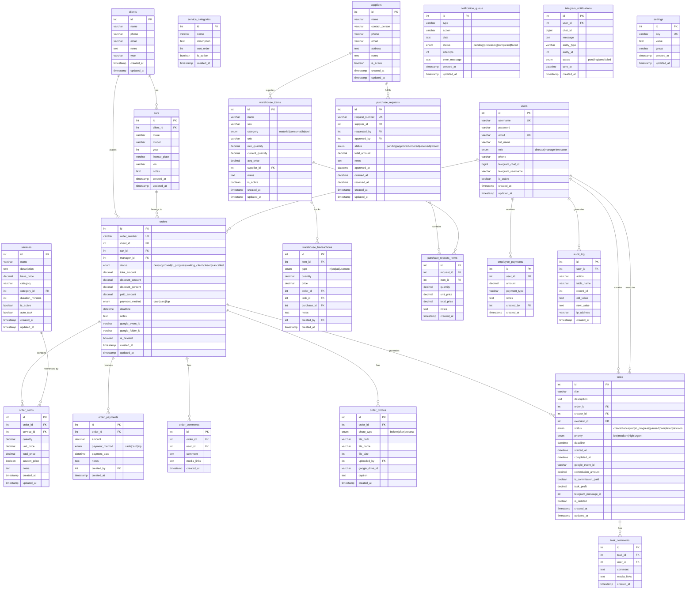

# База даних DetalStudio

## 1. ER-діаграма



---

## 2. Перелік таблиць

### Основні бізнес-таблиці

| Таблиця | Опис | Зв'язки |
|---------|------|---------|
| `users` | Користувачі системи (3 ролі) | → orders, tasks, payments, audit |
| `clients` | Клієнти | → cars, orders |
| `cars` | Автомобілі клієнтів | ← clients, → orders |
| `orders` | Замовлення на детейлінг | ← clients, cars, users → items, payments, tasks |
| `order_items` | Послуги в замовленні | ← orders, services |
| `order_payments` | Оплати замовлень | ← orders, users |
| `order_comments` | Коментарі до замовлень | ← orders, users |
| `order_photos` | Фото замовлення (до/після) | ← orders, users |
| `services` | Каталог послуг | → order_items |
| `service_categories` | Категорії послуг | → services |

### Задачі

| Таблиця | Опис | Зв'язки |
|---------|------|---------|
| `tasks` | Задачі (автономні або по замовленню) | ← orders, users → comments |
| `task_comments` | Коментарі до задач | ← tasks, users |

### Склад та закупівлі

| Таблиця | Опис | Зв'язки |
|---------|------|---------|
| `warehouse_items` | Складські позиції | ← suppliers → transactions |
| `warehouse_transactions` | Рух по складу (in/out/adjustment) | ← items, orders, tasks, purchases, users |
| `suppliers` | Постачальники | → warehouse_items, purchase_requests |
| `purchase_requests` | Заявки на закупівлі | ← suppliers, users → items |
| `purchase_request_items` | Позиції заявки | ← requests, warehouse_items |

### Фінанси та HR

| Таблиця | Опис | Зв'язки |
|---------|------|---------|
| `employee_payments` | Виплати зарплат/авансів | ← users |

### Системні

| Таблиця | Опис | Зв'язки |
|---------|------|---------|
| `audit_log` | Лог всіх дій | ← users |
| `notification_queue` | Черга сповіщень | — |
| `telegram_notifications` | Telegram повідомлення | ← users |
| `settings` | Системні налаштування | — |

---

## 3. Views (представлення)

### `v_order_totals`
Зведена інформація по замовленнях з обчисленим боргом.

```sql
SELECT o.id, o.order_number, o.status, o.total_amount, o.paid_amount,
       (o.total_amount - o.paid_amount) as debt_amount,
       c.name as client_name, car.make, car.model, car.license_plate,
       u.full_name as manager_name, o.deadline, o.created_at
FROM orders o
JOIN clients c ON o.client_id = c.id
JOIN cars car ON o.car_id = car.id
JOIN users u ON o.manager_id = u.id;
```

### `v_task_overview`
Зведена інформація по задачах з відміткою прострочених.

```sql
SELECT t.id, t.title, t.status, t.priority, t.deadline,
       creator.full_name as creator_name, executor.full_name as executor_name,
       o.order_number,
       CASE WHEN t.deadline < NOW() AND t.status NOT IN ('completed','revision') THEN 1 ELSE 0 END as is_overdue
FROM tasks t
LEFT JOIN users creator ON t.creator_id = creator.id
LEFT JOIN users executor ON t.executor_id = executor.id
LEFT JOIN orders o ON t.order_id = o.id;
```

### `v_warehouse_balance`
Баланс складу з відміткою низьких залишків.

```sql
SELECT wi.id, wi.name, wi.sku, wi.category, wi.current_quantity, wi.min_quantity,
       wi.avg_price, (wi.current_quantity * wi.avg_price) as total_value,
       CASE WHEN wi.current_quantity <= wi.min_quantity THEN 1 ELSE 0 END as is_low_stock
FROM warehouse_items wi
WHERE wi.is_active = 1;
```

---

## 4. Foreign Keys та каскадні правила

| Constraint | Таблиця | Колонка | Посилається на | ON DELETE |
|-----------|---------|---------|---------------|-----------|
| `fk_car_client` | cars | client_id | clients.id | CASCADE |
| `fk_order_client` | orders | client_id | clients.id | CASCADE |
| `fk_order_car` | orders | car_id | cars.id | CASCADE |
| `fk_order_manager` | orders | manager_id | users.id | CASCADE |
| `fk_item_order` | order_items | order_id | orders.id | CASCADE |
| `fk_item_service` | order_items | service_id | services.id | CASCADE |
| `fk_payment_order` | order_payments | order_id | orders.id | CASCADE |
| `fk_payment_user` | order_payments | created_by | users.id | CASCADE |
| `fk_comment_order` | order_comments | order_id | orders.id | CASCADE |
| `fk_comment_user` | order_comments | user_id | users.id | CASCADE |
| `fk_photo_order` | order_photos | order_id | orders.id | CASCADE |
| `fk_photo_uploader` | order_photos | uploaded_by | users.id | SET NULL |
| `fk_task_order` | tasks | order_id | orders.id | SET NULL |
| `fk_task_creator` | tasks | creator_id | users.id | CASCADE |
| `fk_task_executor` | tasks | executor_id | users.id | SET NULL |
| `fk_taskcomment_task` | task_comments | task_id | tasks.id | CASCADE |
| `fk_taskcomment_user` | task_comments | user_id | users.id | CASCADE |
| `fk_item_supplier` | warehouse_items | supplier_id | suppliers.id | SET NULL |
| `fk_transaction_item` | warehouse_transactions | item_id | warehouse_items.id | CASCADE |
| `fk_transaction_order` | warehouse_transactions | order_id | orders.id | SET NULL |
| `fk_transaction_task` | warehouse_transactions | task_id | tasks.id | SET NULL |
| `fk_transaction_purchase` | warehouse_transactions | purchase_id | purchase_requests.id | SET NULL |
| `fk_transaction_user` | warehouse_transactions | created_by | users.id | CASCADE |
| `fk_purchase_supplier` | purchase_requests | supplier_id | suppliers.id | CASCADE |
| `fk_purchase_requested` | purchase_requests | requested_by | users.id | CASCADE |
| `fk_purchase_approved` | purchase_requests | approved_by | users.id | SET NULL |
| `fk_pr_item_request` | purchase_request_items | request_id | purchase_requests.id | CASCADE |
| `fk_pr_item_item` | purchase_request_items | item_id | warehouse_items.id | CASCADE |
| `fk_telegram_user` | telegram_notifications | user_id | users.id | SET NULL |
| `fk_audit_user` | audit_log | user_id | users.id | CASCADE |

---

## 5. Міграційна система

### Розташування
`config/migrations/` — 38 файлів

### Формат іменування
```
NNN_description.sql    — SQL міграції (DDL/DML)
NNN_description.php    — PHP міграції (складна логіка)
```

### Виконання
```bash
php migrate.php
```

### Список міграцій

| # | Файл | Опис |
|---|------|------|
| 001 | `add_access_token.php` | Токен доступу |
| 002 | `car_catalog.sql` | Каталог автомобілів |
| 003 | `expand_car_catalog.sql` | Розширення каталогу |
| 004 | `massive_car_catalog.sql` | Масове наповнення каталогу |
| 005 | `soft_delete.sql` | Soft delete для таблиць |
| 006 | `add_telegram_message_id.sql` | Telegram message ID в tasks |
| 007 | `create_employee_payments.sql` | Таблиця виплат |
| 008 | `enhance_services.sql` | Розширення послуг |
| 009 | `service_custom_options.sql` | Кастомні опції послуг |
| 010 | `service_resource_templates.sql` | Шаблони ресурсів послуг |
| 011 | `service_commissions.sql` | Комісії по послугах |
| 012 | `other_expenses.sql` | Інші витрати |
| 012 | `task_commissions.sql` | Комісії по задачах |
| 013 | `notification_queue.sql` | Черга сповіщень |
| 013 | `fix_task_commission_paid.sql` | Фікс commission_paid |
| 014 | `fix_missing_task_columns.sql` | Фікс відсутніх колонок |
| 014 | `create_task_attachments.sql` | Вкладення задач |
| 015 | `add_task_executors.sql` | Виконавці задач |
| 016 | `create_settings_table.sql` | Таблиця налаштувань |
| 017 | `add_auto_task_to_services.sql` | Автоматичні задачі |
| 017 | `remove_obsolete_task_statuses.sql` | Видалення застарілих статусів |
| 018 | `add_client_type.sql` | Тип клієнта |
| 019 | `allow_null_manager.sql` | Nullable manager |
| 020 | `add_google_drive_id_to_photos.sql` | Google Drive ID для фото |
| 022 | `comprehensive_car_catalog.sql` | Повний каталог авто |
| 023 | `trending_ev_and_more.sql` | Електромобілі в каталозі |
| 025 | `fix_audit_log_user_id.sql` | Фікс audit_log |
| 026 | `sync_tasks_to_calendar.php` | Синхронізація задач з Calendar |
| 027 | `add_order_photos.sql` | Фото замовлень |
| 028 | `add_photo_gallery_setting.sql` | Налаштування галереї |
| 029 | `add_security_tables.sql` | Таблиці безпеки |
| 030 | `alter_orders_status_enum.sql` | Розширення enum статусів |
| 031 | `migrate_order_statuses.sql` | Міграція статусів |
| 032 | `optimize_indexes.sql` | Оптимізація індексів |
| 033 | `repair_encoding.sql` | Ремонт кодування |
| 034 | `add_task_profit.sql` | Прибуток задач |
| 035 | `add_remember_token.sql` | Remember token |

### Додавання нових міграцій

1. Створіть файл `config/migrations/NNN_description.sql` (наступний номер)
2. Для складної логіки — `.php` файл з PDO запитами
3. Запустіть `php migrate.php`
4. Система відстежує виконані міграції та пропускає вже застосовані

---

## 6. Індексація

Основні індекси, визначені в схемі:

| Таблиця | Індекс | Колонки | Тип |
|---------|--------|---------|-----|
| users | username | username | UNIQUE |
| users | email | email | UNIQUE |
| orders | order_number | order_number | UNIQUE |
| orders | — | client_id, car_id, manager_id, status, created_at | INDEX |
| tasks | — | order_id, creator_id, executor_id, status, deadline | INDEX |
| warehouse_items | — | category, supplier_id | INDEX |
| warehouse_transactions | — | item_id, type, order_id, task_id, created_by | INDEX |
| audit_log | — | user_id, created_at | INDEX |
| purchase_requests | request_number | request_number | UNIQUE |
| clients | — | phone | INDEX |
| cars | — | client_id, license_plate | INDEX |

> Додаткова оптимізація індексів виконана в міграції `032_optimize_indexes.sql`.
