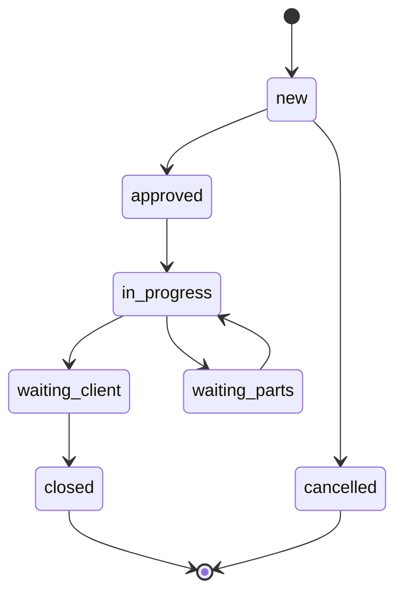
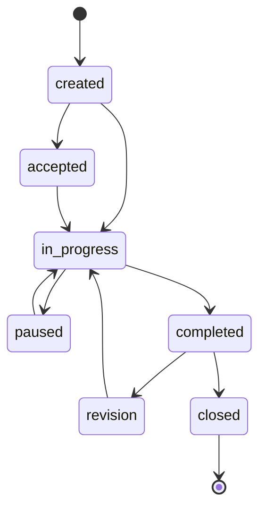

# Моделі — DetalStudio

Domain layer системи. Кожна модель — PHP клас в `includes/Models/`, namespace `App\Models`.

Всі моделі використовують статичні методи та PDO через глобальну функцію `db()`.

## Загальні патерни

```php
// Отримання одного запису
$order = Order::getById(42);

// Отримання списку з фільтрами
$tasks = Task::getList(['status' => 'in_progress', 'executor_id' => 5]);

// Створення
$id = Client::create(['name' => 'Іван', 'phone' => '+380...']);

// Оновлення
Order::update(42, ['status' => 'closed']);

// Видалення (soft)
Task::delete(15);
```

---

## Order (Замовлення)

**Файл**: `includes/Models/Order.php`
**Таблиця**: `orders`, `order_items`, `order_payments`, `order_comments`, `order_photos`
**Traits**: `OrderItems`, `OrderLifecycle`, `OrderPayments`

### Статуси



### Ключові методи

| Метод | Опис |
|-------|------|
| `getById($id)` | Замовлення з клієнтом, авто, менеджером |
| `getList($filters)` | Список з ціною, клієнтом, авто, статусом |
| `create($data)` | Створення + dispatch OrderCreated |
| `update($id, $data)` | Оновлення + dispatch OrderUpdated/StatusChanged |
| `delete($id)` | Soft delete |
| `getStatusName($status)` | Переклад статусу |
| `addItem(...)` | Додавання послуги (через OrderItems trait) |
| `addPayment(...)` | Додавання платежу (через OrderPayments trait) |
| `getForCalendar($start, $end)` | Замовлення для FullCalendar |

---

## Task (Задача)

**Файл**: `includes/Models/Task.php`
**Таблиця**: `tasks`, `task_comments`

### Статуси



### Ключові методи

| Метод | Опис |
|-------|------|
| `getById($id)` | Задача з автором, виконавцем, замовленням |
| `getList($filters)` | Список з фільтрами (status, executor_id, order_id) |
| `create($data)` | Створення + dispatch TaskCreated |
| `update($id, $data)` | Оновлення + dispatch TaskUpdated/StatusChanged |
| `delete($id)` | Soft delete |
| `getOverdue()` | Прострочені задачі |
| `getForCalendar($start, $end)` | Задачі для FullCalendar |
| `getStatusName($status)` | Переклад статусу |

---

## Client (Клієнт)

**Файл**: `includes/Models/Client.php`
**Таблиця**: `clients`

| Метод | Опис |
|-------|------|
| `getById($id)` | Клієнт з кількістю замовлень |
| `getAll()` | Всі клієнти |
| `create($data)` | Створення |
| `update($id, $data)` | Оновлення |
| `delete($id)` | Видалення |
| `search($query)` | Пошук по імені/телефону |
| `getStats($id)` | Статистика (замовлення, сума) |

---

## Car (Автомобіль)

**Файл**: `includes/Models/Car.php`
**Таблиця**: `cars`

| Метод | Опис |
|-------|------|
| `getById($id)` | Авто з клієнтом |
| `getByClient($clientId)` | Авто клієнта |
| `create($data)` | Створення |
| `update($id, $data)` | Оновлення |
| `delete($id)` | Видалення |

---

## Service (Послуга)

**Файл**: `includes/Models/Service.php`
**Таблиця**: `services`

| Метод | Опис |
|-------|------|
| `getAll()` | Всі послуги (з категоріями) |
| `getActive()` | Активні послуги |
| `getById($id)` | Послуга |
| `create($data)` | Створення |
| `update($id, $data)` | Оновлення |
| `getByCategory($categoryId)` | Послуги категорії |

---

## WarehouseItem (Складська позиція)

**Файл**: `includes/Models/WarehouseItem.php`
**Таблиця**: `warehouse_items`, `warehouse_transactions`

| Метод | Опис |
|-------|------|
| `getById($id)` | Позиція з транзакціями |
| `getAll()` | Всі позиції |
| `getLowStock()` | Позиції з низьким залишком |
| `addStock($id, $qty, $price, ...)` | Прихід |
| `removeStock($id, $qty, ...)` | Списання |
| `adjustStock($id, $qty, ...)` | Корекція |
| `getTransactions($id)` | Історія руху |

---

## PurchaseRequest (Заявка на закупку)

**Файл**: `includes/Models/PurchaseRequest.php`
**Таблиця**: `purchase_requests`, `purchase_request_items`

**Статуси**: pending → approved → ordered → received → closed

| Метод | Опис |
|-------|------|
| `getById($id)` | Заявка з позиціями |
| `create($data)` | Створення |
| `updateStatus($id, $status)` | Зміна статусу |
| `addItem($requestId, $itemData)` | Додавання позиції |

---

## Інші моделі

| Модель | Файл | Таблиця | Призначення |
|--------|------|---------|-------------|
| `Supplier` | `Models/Supplier.php` | `suppliers` | Постачальники |
| `Expense` | `Models/Expense.php` | `expenses` | Інші витрати |
| `ServiceCategory` | `Models/ServiceCategory.php` | `service_categories` | Категорії послуг |
| `Setting` | `Models/Setting.php` | `settings` | Налаштування (key-value) |
| `Stall` | `Models/Stall.php` | `stalls` | Робочі місця/бокси |
