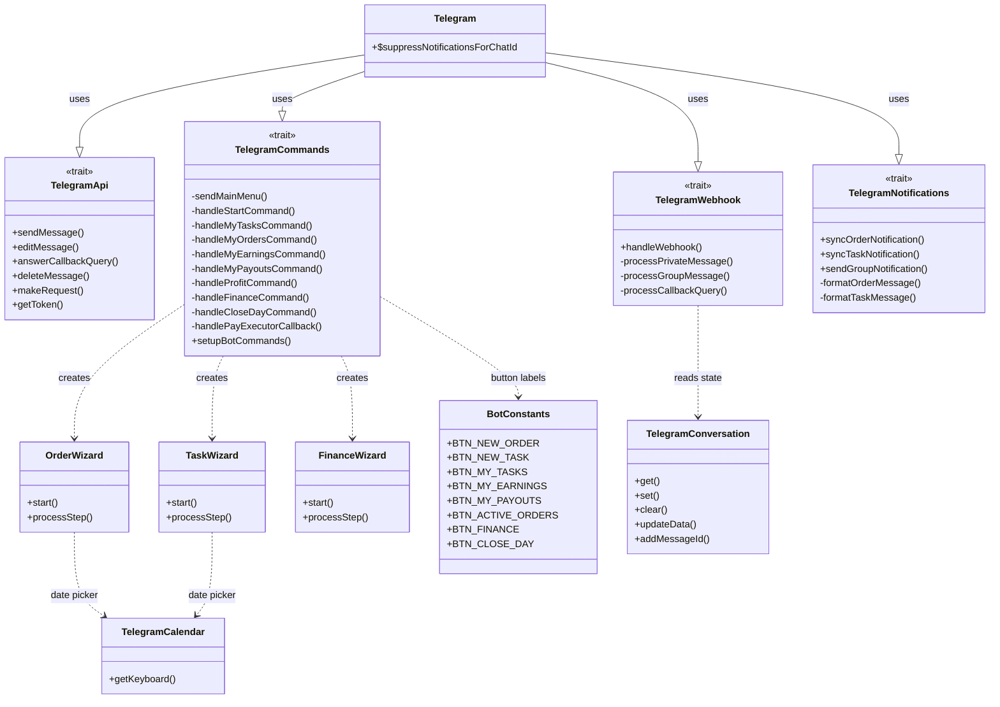
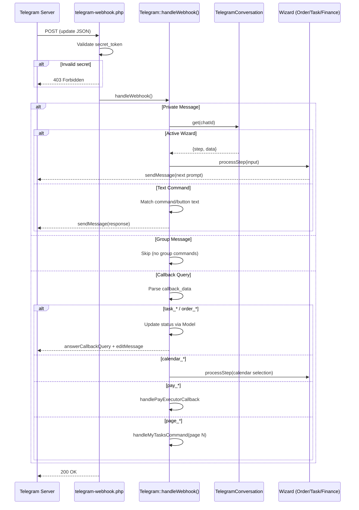
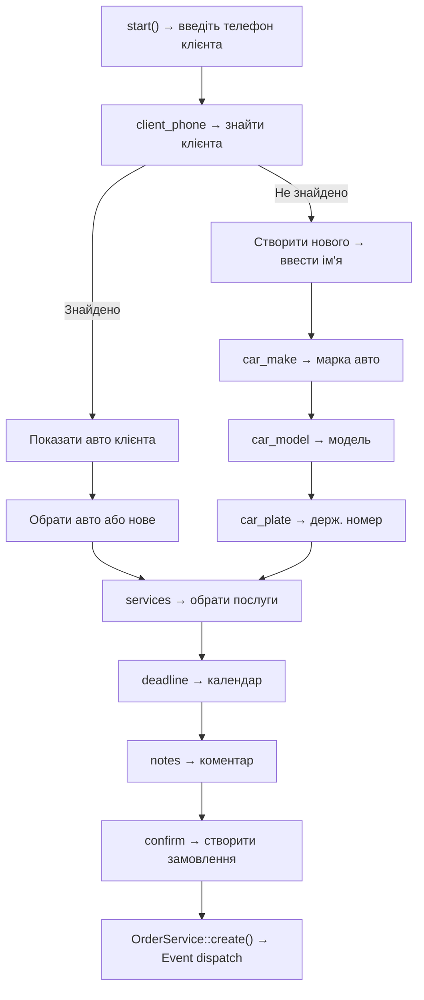
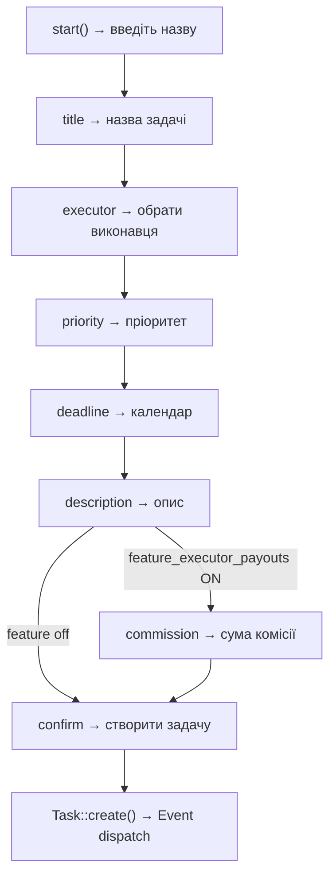

# Telegram Bot — DetalStudio

## 1. Архітектура

### Trait-based Design

Головний клас `App\Telegram` складається з 4 traits та 3 зовнішніх wizards:



### Файлова структура

| Файл | Клас/Trait | Відповідальність |
|------|-----------|------------------|
| `includes/Telegram.php` | `App\Telegram` | Головний клас (compositor) |
| `includes/Traits/TelegramApi.php` | `TelegramApi` | HTTP запити до Bot API |
| `includes/Traits/TelegramCommands.php` | `TelegramCommands` | Команди, меню, обробники |
| `includes/Traits/TelegramWebhook.php` | `TelegramWebhook` | Обробка вхідних webhook |
| `includes/Traits/TelegramNotifications.php` | `TelegramNotifications` | Sync повідомлення |
| `includes/OrderWizard.php` | `App\OrderWizard` | Wizard створення замовлення |
| `includes/TaskWizard.php` | `App\TaskWizard` | Wizard створення задачі |
| `includes/FinanceWizard.php` | `App\FinanceWizard` | Wizard фінансових операцій |
| `includes/TelegramConversation.php` | `App\TelegramConversation` | Стан діалогів (БД) |
| `includes/TelegramCalendar.php` | `App\TelegramCalendar` | Inline calendar keyboard |
| `includes/BotConstants.php` | `App\BotConstants` | UI константи кнопок |
| `telegram-webhook.php` | — | Entry point для webhook |

---

## 2. Webhook Flow



---

## 3. Команди та кнопки

### Меню для Виконавця (Executor)

| Кнопка | Константа | Дія |
|--------|-----------|-----|
| 📋 Активні задачі | `BTN_MY_TASKS` | Список активних задач з пагінацією |
| 📊 Мій заробіток | `BTN_MY_EARNINGS` | Зароблено сьогодні + загальний борг |
| 💳 Історія виплат | `BTN_MY_PAYOUTS` | Останні 10 виплат |

### Меню для Менеджера/Директора

| Кнопка | Константа | Дія | Ролі |
|--------|-----------|-----|------|
| ➕ Нове замовлення | `BTN_NEW_ORDER` | Запуск OrderWizard | manager, director |
| 📝 Нова задача | `BTN_NEW_TASK` | Запуск TaskWizard | manager, director |
| 📋 Активні задачі | `BTN_MY_TASKS` | Список задач | all |
| 📊 Мій заробіток | `BTN_MY_EARNINGS` | Заробіток | all |
| 💳 Історія виплат | `BTN_MY_PAYOUTS` | Виплати | all |
| 📦 Активні замовлення | `BTN_ACTIVE_ORDERS` | Список замовлень з кнопками | manager, director |
| 💸 Фінанси | `BTN_FINANCE` | FinanceWizard (фін. звіт) | director |
| 💸 Закрити день | `BTN_CLOSE_DAY` | Виплати виконавцям | manager, director |

### Slash-команди

| Команда | Опис |
|---------|------|
| `/start` | Прив'язка акаунту + головне меню |
| `/start task_{id}` | Deep link — перегляд задачі |
| `/my_tasks` | Список активних задач |
| `/help` | Довідка |

---

## 4. Wizards (Покрокові діалоги)

Wizards використовують `TelegramConversation` для збереження стану між повідомленнями. Стан зберігається в таблиці `telegram_conversations` (chat_id → step + data JSON).

### OrderWizard — Створення замовлення



**Кроки**: `client_phone` → `client_name` → `car_select` → `car_make` → `car_model` → `car_plate` → `services` → `deadline` → `notes` → `confirm`

### TaskWizard — Створення задачі



**Кроки**: `title` → `executor` → `priority` → `deadline` → `description` → `task_commission` (optional) → `confirm`

### FinanceWizard — Фінансові операції

Запускається через кнопку «💸 Фінанси» (тільки директор). Показує фінансовий звіт (дохід/витрати/прибуток за сьогодні та місяць).

---

## 5. Notification System

### Topics (Threads) супергрупи

Повідомлення розподіляються по топіках для організації:

| Топік | Константа | Що потрапляє |
|-------|-----------|--------------|
| Замовлення | `TELEGRAM_TOPIC_ORDERS` | Нові замовлення, зміни статусів, видалення |
| Задачі | `TELEGRAM_TOPIC_TASKS` | Нові задачі, зміни статусів, видалення |
| Фінанси | `TELEGRAM_TOPIC_FINANCE` | Платежі, виплати |
| Сповіщення | `TELEGRAM_TOPIC_ALERTS` | Дедлайни, критичні попередження |
| Загальне | `TELEGRAM_TOPIC_GENERAL` | Бекапи, системні повідомлення |

### Sync Notifications

Система використовує **sync notifications** — замість створення нових повідомлень при зміні статусу, вона **оновлює існуюче повідомлення** (edit). Це запобігає замусоренню чату.

```php
// Приклад: при зміні статусу замовлення
Telegram::syncOrderNotification($orderId);
// → Знаходить message_id пов'язаного повідомлення
// → Оновлює текст та inline-кнопки через editMessageText
```

### Inline Keyboards

Повідомлення про замовлення/задачі мають **inline-кнопки** для швидкої зміни статусу:

**Задачі**:
- `task_progress_{id}` — Взяти в роботу
- `task_complete_{id}` — Позначити готовим
- `task_reject_{id}` — Відхилити

**Замовлення** (в списку):
- `olist_progress_{id}` — В роботу
- `olist_cancel_{id}` — Відхилити
- `olist_close_{id}` — Закрити

**Пагінація**:
- `page_tasks_{N}` — Сторінка N списку задач

**Виплати**:
- `pay_{executor_id}` — Виплатити борг виконавцю

**Календар**:
- `calendar_day_{YYYY-MM-DD}` — Вибрана дата
- `calendar_nav_{YYYY}_{MM}` — Навігація по місяцях

---

## 6. Inline Calendar

`TelegramCalendar::getKeyboard()` генерує inline keyboard у вигляді календаря:

```
┌──────────────────────┐
│     Квітень 2026     │  ← Заголовок
├──┬──┬──┬──┬──┬──┬──┤
│Пн│Вт│Ср│Чт│Пт│Сб│Нд│  ← Дні тижня
├──┼──┼──┼──┼──┼──┼──┤
│  │  │ 1│ 2│[3]│ 4│ 5│  ← [3] = сьогодні
│ 6│ 7│ 8│ 9│10│11│12│
│...                   │
├──────────────────────┤
│   <<    │    >>      │  ← Навігація
└──────────────────────┘
```

**Параметри**:
- `$year`, `$month` — рік та місяць для відображення
- `$prefix` — префікс callback_data (за замовчуванням `calendar_`)

**Callback data формат**:
- `{prefix}day_{YYYY-MM-DD}` — клік по дню
- `{prefix}nav_{YYYY}_{MM}` — навігація
- `{prefix}ignore` — пустий клік (заголовки)

---

## 7. BotConstants

Клас `App\BotConstants` централізує всі текстові рядки кнопок. Це критично важливо, оскільки Telegram webhook використовує **точне співпадіння тексту кнопки** для маршрутизації:

```php
class BotConstants {
    public const BTN_NEW_ORDER       = '➕ Нове замовлення';
    public const BTN_NEW_TASK        = '📝 Нова задача';
    public const BTN_MY_TASKS        = '📋 Активні задачі';
    public const BTN_MY_EARNINGS     = '📊 Мій заробіток';
    public const BTN_MY_PAYOUTS      = '💳 Історія виплат';
    public const BTN_ACTIVE_ORDERS   = '📦 Активні замовлення';
    public const BTN_FINANCE         = '💸 Фінанси';
    public const BTN_CLOSE_DAY       = '💸 Закрити день';
}
```

> ⚠️ **Важливо**: При зміні emoji або пробілів у кнопках — оновлюйте **і** `BotConstants`, **і** обробник в `TelegramWebhook`. Невідповідність призведе до того, що бот не розпізнає натискання кнопки.

---

## 8. Conversation State Management

`TelegramConversation` зберігає стан діалогу в БД (таблиця `telegram_conversations`):

| Метод | Опис |
|-------|------|
| `get($chatId)` | Отримати поточний стан (step + data JSON) |
| `set($chatId, $step, $data, $userId)` | Оновити/створити стан |
| `clear($chatId)` | Видалити стан (завершення wizard) |
| `updateData($chatId, $key, $value)` | Оновити одне поле без зміни step |
| `addMessageId($chatId, $messageId)` | Зберегти ID для подальшого cleanup |
| `getMessages($chatId)` | Отримати збережені message IDs |

**Data JSON** містить зібрані дані wizard'а:
```json
{
  "client_id": 42,
  "car_id": 15,
  "services": [1, 3, 5],
  "deadline": "2026-04-10",
  "_cleanup_ids": [1234, 1235, 1236]
}
```

`_cleanup_ids` — масив message IDs, які wizard видалить після завершення для підтримки чистоти чату.

---

## 9. Безпека

### Webhook Secret Token

Файл `telegram-webhook.php` перевіряє заголовок `X-Telegram-Bot-Api-Secret-Token`:

```php
$webhookSecret = $_ENV['TELEGRAM_WEBHOOK_SECRET'] ?? '';
if ($webhookSecret !== '') {
    $receivedToken = $_SERVER['HTTP_X_TELEGRAM_BOT_API_SECRET_TOKEN'] ?? '';
    if (!hash_equals($webhookSecret, $receivedToken)) {
        http_response_code(403);
        exit('Forbidden');
    }
}
```

### User Binding

Прив'язка Telegram → User здійснюється через `telegram_username`:
1. Адміністратор вказує `telegram_username` у профілі користувача (web)
2. Користувач натискає `/start` у боті
3. Бот знаходить user по `telegram_username`, зберігає `telegram_chat_id`

### Перевірка прав

Кожна команда перевіряє роль користувача перед виконанням:
```php
$stmt = db()->prepare("SELECT * FROM users WHERE telegram_chat_id = ? AND is_active = 1");
$stmt->execute([$chatId]);
$user = $stmt->fetch();

if (!$user || !in_array($user['role'], ['director', 'manager'])) {
    self::sendMessage($chatId, "🚫 У вас немає прав.");
    return;
}
```

### Logging

Всі вхідні webhook запити логуються в `logs/telegram_webhook.log` для дебагу.

---

## 10. Налаштування

### Встановлення webhook

```bash
curl -F "url=https://your-domain.com/telegram-webhook.php" \
     -F "secret_token=YOUR_SECRET" \
     https://api.telegram.org/botYOUR_TOKEN/setWebhook
```

### Перевірка webhook

```bash
curl https://api.telegram.org/botYOUR_TOKEN/getWebhookInfo
```

### Налаштування команд бота

```bash
php scripts/setup_telegram_menu.php
```

Або програмно:
```php
Telegram::setupBotCommands();
```

### Змінні оточення (.env)

```env
TELEGRAM_BOT_TOKEN=your_bot_token
TELEGRAM_GROUP_CHAT_ID=your_group_id
TELEGRAM_WEBHOOK_URL=https://your-domain.com/telegram-webhook.php
TELEGRAM_WEBHOOK_SECRET=random_secret_string
```

### Топіки (config.php)

```php
define('TELEGRAM_TOPIC_ORDERS', $_ENV['TELEGRAM_TOPIC_ORDERS'] ?? 79);
define('TELEGRAM_TOPIC_TASKS', $_ENV['TELEGRAM_TOPIC_TASKS'] ?? 80);
define('TELEGRAM_TOPIC_FINANCE', $_ENV['TELEGRAM_TOPIC_FINANCE'] ?? 81);
define('TELEGRAM_TOPIC_ALERTS', $_ENV['TELEGRAM_TOPIC_ALERTS'] ?? 82);
define('TELEGRAM_TOPIC_GENERAL', $_ENV['TELEGRAM_TOPIC_GENERAL'] ?? 87);
```
